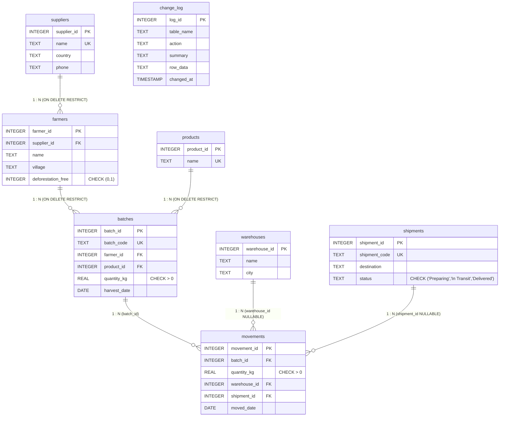

# Simple Supply Chain Traceability DBMS

A college-level Database Management System (DBMS) demonstrating relational architecture, 3NF normalization, foreign key integrity, business rule checks, and end-to-end supply chain traceability.

---

## The One Idea

> **"Follow a product from the farmer to the shipment. Every step is saved in connected tables, and we trace it using Primary Keys and Foreign Keys."**

```
Supplier (PK) ──> Farmer (FK -> Supplier) ──> Batch (FK -> Farmer, Product) ──> Movements (FK -> Warehouse / Shipment)
```

---

## Database Architecture (3NF & Foreign Key Integrity)

The database consists of **6 core tables + 1 change log table**, created with `PRAGMA foreign_keys = ON` and indexes on every foreign key.

### Entity Relationship (ER) Diagram



### Views

1. **`v_batch_balance`**: Calculates `total_kg`, `sent_kg`, and `remaining_kg` (kg still held with the supplier) by subtracting total moved kg from batch harvest kg.
2. **`v_trace`**: Full multi-table `JOIN` linking `movements` $\rightarrow$ `batches` $\rightarrow$ `products` $\rightarrow$ `farmers` $\rightarrow$ `suppliers` $\rightarrow$ `warehouses` / `shipments`.

---

## 3-Minute Viva Demo Script

| Step | Action | What to Say / What Happens |
|---|---|---|
| **1** | Open **1. Suppliers** &rarr; Click **"Add Supplier"** | Enter "Coorg Specialty Traders" (India). Show the new supplier appear in the table. |
| **2** | Open **2. Farmers** &rarr; Click **"Add Farmer"** | Select supplier "Coorg Specialty Traders" from the required dropdown. Enter farmer "Suresh Gowda" in Somwarpet. The foreign key `supplier_id` connects them. |
| **3** | Open **3. Batches** &rarr; Click **"Add Batch"** | Pick Suresh Gowda, select "Coffee", and enter **50 kg**. Notice the batch code **`COF-0005`** is auto-generated and `remaining_kg` is 50. |
| **4** | Click **"Send to Warehouse"** &rarr; Send **30 kg** | Partial send: Send 30 kg to Cochin Port Warehouse. Remaining drops to 20 kg. |
| **5** | Click **"Send to Shipment"** &rarr; Send **20 kg** | Send remaining 20 kg to shipment `SHP-0001`. Remaining drops to **0 kg**. |
| **6** | Watch the **"Database Changes" drawer** | Point out the drawer opening on every action: plain sentence, table changed diff, executed SQL, and the exact Primary/Foreign Key used. |
| **7** | Try to send **1 more kg** | Click Send with 1 kg: A friendly block appears: *"Only 0 kg left, cannot send 1 kg"*. |
| **8** | Try sending non-compliant batch `COF-0004` to Shipment | Dewi Lestari has `deforestation_free = 0`. System blocks: *"This farm's land was cleared after 31 Dec 2020. Not allowed to ship to the EU."* (Sending to Warehouse is allowed). |
| **9** | Open **Track a Product** | Select `COF-0001` or `SHP-0001`. Click **"Trace Forward"** or **"Trace Back to Farm"** to see the 5-table chain. |
| **10** | Open **Data Tables** &amp; **Ask the Database (SQL)** | Switch between **Simple View** and **Database View**. Run query 5 (*Full trace of a shipment across 5 tables*). |

---

## 8 Simple Viva Questions & Answers

#### Q1: What is a Primary Key (PK)?
**A:** A primary key is a column (or columns) that uniquely identifies each row in a table. It cannot contain NULL values and ensures entity integrity (e.g., `supplier_id` in `suppliers`).

#### Q2: What is a Foreign Key (FK)?
**A:** A foreign key is a column in one table that references the primary key of another table. It creates relationships between tables and enforces referential integrity (e.g., `farmers.supplier_id` references `suppliers.supplier_id`).

#### Q3: Why is this database in Third Normal Form (3NF)?
**A:** Because all non-key columns depend directly on the primary key, the whole primary key, and nothing but the primary key (no transitive dependencies). For example, supplier details like country and phone are stored in `suppliers`, not repeated inside `farmers`.

#### Q4: Why do we use `ON DELETE RESTRICT`?
**A:** It prevents orphaned rows and protects critical relationships. A supplier cannot be accidentally deleted while it still has linked farmers, and a farmer cannot be deleted while batches exist.

#### Q5: What is a Database View and why do we use `v_batch_balance`?
**A:** A view is a saved virtual query that acts like a table without duplicating data. `v_batch_balance` calculates `remaining_kg` dynamically from `quantity_kg - SUM(movements)` so balance is always real-time and accurate.

#### Q6: What is a SQL `JOIN`?
**A:** A `JOIN` combines rows from two or more tables based on a related column between them (typically PK and FK). For example, joining `farmers` and `suppliers` on `farmers.supplier_id = suppliers.supplier_id`.

#### Q7: Why do we add indexes on every Foreign Key?
**A:** SQLite automatically indexes primary keys, but foreign keys are not indexed by default. Indexing foreign keys accelerates table joins and prevents full table scans when checking foreign key constraints.

#### Q8: How does the system enforce business rules (like deforestation cutoff)?
**A:** Critical rules are validated directly at the transaction boundary before executing writes: checking that `quantity_kg <= remaining_kg` and that `deforestation_free == 1` before allowing export to shipments.

---

## Running the Application Locally

1. Install requirements:
   ```bash
   pip install -r requirements.txt pytest
   ```

2. Run the application:
   ```bash
   python app.py
   ```
   Open your browser at **[http://localhost:5000](http://localhost:5000)**.

3. Run terminal verification tests:
   ```bash
   pytest -v test_app.py
   ```
