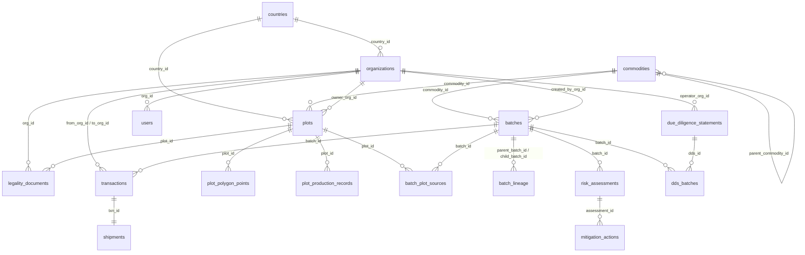

# EUDR TraceChain: Enterprise Supply Chain Traceability DBMS
**Regulation (EU) 2023/1115 as amended by (EU) 2025/2650**
*A 3rd Normal Form (3NF) Relational Database Architecture & Compliance Platform*

---

## 1. Project Overview
**EUDR TraceChain** is an enterprise-grade database management system and full-stack compliance platform built to enforce the requirements of the European Union Deforestation Regulation (EUDR). 

The platform models multi-tier global supply chains—from smallholder farm plots across Ghana, Brazil, Indonesia, Ivory Coast, and India to European placing operators—demonstrating rigorous relational design, recursive lineage resolution (Forward and Backward Common Table Expressions), geolocation polygon enforcement, and trigger-driven audit logging.

---

## 2. EUDR Regulatory Domain Model
- **7 Regulated Commodities**: Cattle, Cocoa, Coffee, Oil Palm, Rubber, Soya, Wood (and derived products mapped by CN/HS tariff codes).
- **Cut-off Baseline Date**: **31 December 2020**. Any agricultural commodity produced on land deforested or degraded after this timestamp is prohibited from EU entry.
- **Geolocation Mandate (Article 9)**: 
  - Latitude and longitude with 6 decimal places.
  - Parcels &le; 4.0 hectares: Single point coordinate.
  - Parcels &gt; 4.0 hectares: Strict multi-point polygon boundary coordinates.
- **3-Step Due Diligence Framework**:
  1. *Information Collection*: HS codes, quantities, exact parcel coordinates, legality documents.
  2. *Risk Assessment*: Composite scoring across country benchmarks (Art. 29), satellite deforestation alerts, supplier tenure, and document verification.
  3. *Risk Mitigation & DDS Generation*: Audits, satellite re-verification, and official Due Diligence Statement (DDS) submission to EU Customs.
- **Anti-Mixing Safeguard**: Mixing compliant batches with unknown or non-compliant origins is blocked at the database trigger level.

---

## 3. Database Schema Design (3NF & Integrity Rules)



### The 18 Relational Tables
1. `countries`: Country risk benchmark (Low / Standard / High), 2-letter ISO codes.
2. `commodities`: 7 core commodities + derived products with CN/HS classification codes.
3. `organizations`: Supply chain actors (Farmer, Cooperative, Processor, Exporter, Importer-Operator) with EORI numbers and SME flags.
4. `users`: System users and auditor profiles with role-based access.
5. `plots`: Land parcel geolocations, owner linkage, area (ha), and POINT/POLYGON geometry flags.
6. `plot_polygon_points`: Sequential polygon vertex coordinate pairs for parcels > 4.0 ha.
7. `plot_production_records`: Harvest timestamps, deforestation-free flags, satellite verification records.
8. `legality_documents`: Land titles, environmental permits, labour compliance, and harvest licenses.
9. `batches`: Commodity lots with quantities, types (RAW, PROCESSED, MIXED), and compliance statuses.
10. `batch_plot_sources`: Many-to-many junction linking raw batches directly to farm plots.
11. `batch_lineage`: Recursive self-referencing junction modeling multi-tier processing and blending.
12. `transactions`: Chain of custody handoffs between distinct organizations.
13. `shipments`: International transport logistics and entry port tracking.
14. `risk_assessments`: Composite 4-factor risk scoring engine.
15. `mitigation_actions`: Corrective audits and satellite inspections for non-negligible risk.
16. `due_diligence_statements`: Official EU DDS filing records with unique reference codes.
17. `dds_batches`: Many-to-many junction linking statements to compliant product batches.
18. `audit_log`: Immutable, trigger-driven transaction log recording every INSERT, UPDATE, and DELETE.

---

## 4. How to Run the Project

### Prerequisites
- Python 3.8+ (with pip)

### Quick Start (Single Command)
```bash
# 1. Install dependencies
pip install -r requirements.txt

# 2. Start the application
python app.py
```

Open your browser at **`http://localhost:5000`**.

On first execution, the application automatically constructs `eudr.db` from `schema.sql` and loads the realistic international supply chain dataset from `seed.sql`.

---

## 5. 3-Minute Demo Script for Teacher or Viva

Follow this simple, step-by-step walkthrough to explain the project in under 3 minutes:

| Time | What to Click | What to Say (Simple Words) |
|---|---|---|
| **0:00 - 0:45** | **Home** &rarr; Point to the 5-step flow | *"EU law (EUDR) says products like cocoa, coffee, and palm oil must not come from land deforested after 31 Dec 2020. Our system tracks goods in 5 steps: Companies, Farm Plots, Batches, Safety Check, and EU Reports."* |
| **0:45 - 1:15** | Click **Track a Product** in the sidebar | *"Here is our hero feature. Pick chocolate batch `NL-CHOC-2026-0044` and click 'Trace back to farms'. The database uses a recursive query to walk backwards through 5 companies all the way to 3 farm plots in Ghana with exact GPS locations."* |
| **1:15 - 1:45** | Click **2. Farm Plots & Map** | *"On the map, green plots are safe and red plots are deforested. Plots bigger than 4 hectares automatically require a polygon boundary fence. Notice the Pelalawan plot shows 'Waiting' because its land papers are unverified."* |
| **1:45 - 2:15** | Click **Automatic Rules** &rarr; Click **Try It** on Rule 1 | *"We don't rely only on code; the SQLite database has triggers. If I try to approve a batch from a deforested plot, the database BLOCKS it automatically with an ABORT error. It's impossible to smuggle illegal goods."* |
| **2:15 - 2:45** | Click **Ask the Database (SQL)** &rarr; Click Question 1 | *"For the viva, we have 10 ready-made plain English questions. Click 'Which farms supplied chocolate batch?' and the database runs the recursive SQL query and explains the results in 1 second."* |
| **2:45 - 3:00** | Click **Start Demo Tour** (yellow button) | *"Anyone can click this yellow button to see a 7-step guided tour of everything the teacher needs to evaluate."* |

---

## 6. 10 Simple Viva Questions & 2-Line Answers

### Q1: What does EUDR require and what is the cut-off date?
> **Answer**: EUDR requires companies to prove products did not cause deforestation. The legal cut-off date is **31 December 2020**; any land cleared after this date is illegal to import from.

### Q2: Why is the database designed in 3rd Normal Form (3NF)?
> **Answer**: We separated data into 18 tables so details like company names and country risk are stored only once. This eliminates duplicate errors and stops update anomalies.

### Q3: How do you trace a chocolate bar back to the exact farm?
> **Answer**: We use a **Recursive CTE query** (`WITH RECURSIVE`) that follows parent-child batch links step-by-step through the `batch_lineage` table all the way to the origin farm plots.

### Q4: How does the database stop someone from approving an illegal batch?
> **Answer**: An automatic `BEFORE UPDATE` trigger on the `batches` table checks all source plots. If any plot had tree loss after 2020 or lacks verified papers, the database aborts the update.

### Q5: What is the rule for farm plots bigger than 4 hectares?
> **Answer**: Under Article 9, plots &le; 4.0 hectares can use a single GPS point, but plots &gt; 4.0 hectares **must** have a polygon boundary with at least 3 corner points.

### Q6: Why did the Pelalawan plot show "Waiting" instead of "Approved"?
> **Answer**: Even though satellite scans were clear, its land ownership document is unverified (`verified = 0`). The system requires both clear land and verified legal papers.

### Q7: Why use Raw SQL instead of an ORM?
> **Answer**: Raw SQL lets us demonstrate relational algebra, recursive CTEs, and database-level triggers directly so teachers can see the exact database performance and query plan.

### Q8: How is SQL injection prevented?
> **Answer**: Every query uses parameterized placeholders (`?`). User inputs are passed separately as parameters to SQLite and are never glued into the SQL string.

### Q9: How does the Automatic Change History (Audit Log) work?
> **Answer**: Database triggers on `batches`, `plots`, and `due_diligence_statements` automatically record every insert, update, or delete into the `audit_log` table with old and new values.

### Q10: What is an EU Report (DDS)?
> **Answer**: A Due Diligence Statement (DDS) is the official electronic document submitted to the EU customs portal before selling. It lists the approved batches and assigns an official reference number.

---

## 7. Educational Disclaimer
*This project was developed for academic demonstration to showcase relational database architecture, recursive SQL queries, and compliance automation under Regulation (EU) 2023/1115.*

