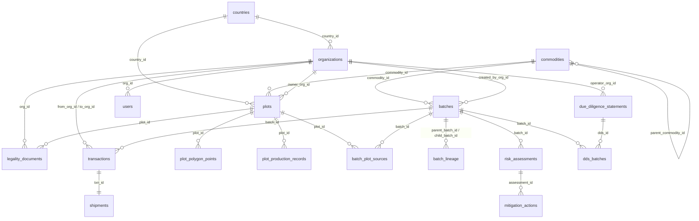

# EUDR TraceChain: Enterprise Supply Chain Traceability DBMS
**Regulation (EU) 2023/1115 as amended by (EU) 2025/2650**
*A 3rd Normal Form (3NF) Relational Database Architecture & Compliance Platform*

---

## 1. Project Overview
**EUDR TraceChain** is an enterprise-grade database management system and full-stack compliance platform built to enforce the requirements of the European Union Deforestation Regulation (EUDR). 

The platform models multi-tier global supply chains—from smallholder farm plots across Ghana, Brazil, Indonesia, Ivory Coast, and India to European placing operators—demonstrating rigorous relational design, recursive lineage resolution (Forward and Backward Common Table Expressions), geolocation polygon enforcement, and trigger-driven audit logging.

---

## 2. EUDR Regulatory Domain Model
- **7 Regulated Commodities**: Cattle, Cocoa, Coffee, Oil Palm, Rubber, Soya, Wood (and derived products mapped by CN/HS tariff codes).
- **Cut-off Baseline Date**: **31 December 2020**. Any agricultural commodity produced on land deforested or degraded after this timestamp is prohibited from EU entry.
- **Geolocation Mandate (Article 9)**: 
  - Latitude and longitude with 6 decimal places.
  - Parcels &le; 4.0 hectares: Single point coordinate.
  - Parcels &gt; 4.0 hectares: Strict multi-point polygon boundary coordinates.
- **3-Step Due Diligence Framework**:
  1. *Information Collection*: HS codes, quantities, exact parcel coordinates, legality documents.
  2. *Risk Assessment*: Composite scoring across country benchmarks (Art. 29), satellite deforestation alerts, supplier tenure, and document verification.
  3. *Risk Mitigation & DDS Generation*: Audits, satellite re-verification, and official Due Diligence Statement (DDS) submission to EU Customs.
- **Anti-Mixing Safeguard**: Mixing compliant batches with unknown or non-compliant origins is blocked at the database trigger level.

---

## 3. Database Schema Design (3NF & Integrity Rules)



### The 18 Relational Tables
1. `countries`: Country risk benchmark (Low / Standard / High), 2-letter ISO codes.
2. `commodities`: 7 core commodities + derived products with CN/HS classification codes.
3. `organizations`: Supply chain actors (Farmer, Cooperative, Processor, Exporter, Importer-Operator) with EORI numbers and SME flags.
4. `users`: System users and auditor profiles with role-based access.
5. `plots`: Land parcel geolocations, owner linkage, area (ha), and POINT/POLYGON geometry flags.
6. `plot_polygon_points`: Sequential polygon vertex coordinate pairs for parcels > 4.0 ha.
7. `plot_production_records`: Harvest timestamps, deforestation-free flags, satellite verification records.
8. `legality_documents`: Land titles, environmental permits, labour compliance, and harvest licenses.
9. `batches`: Commodity lots with quantities, types (RAW, PROCESSED, MIXED), and compliance statuses.
10. `batch_plot_sources`: Many-to-many junction linking raw batches directly to farm plots.
11. `batch_lineage`: Recursive self-referencing junction modeling multi-tier processing and blending.
12. `transactions`: Chain of custody handoffs between distinct organizations.
13. `shipments`: International transport logistics and entry port tracking.
14. `risk_assessments`: Composite 4-factor risk scoring engine.
15. `mitigation_actions`: Corrective audits and satellite inspections for non-negligible risk.
16. `due_diligence_statements`: Official EU DDS filing records with unique reference codes.
17. `dds_batches`: Many-to-many junction linking statements to compliant product batches.
18. `audit_log`: Immutable, trigger-driven transaction log recording every INSERT, UPDATE, and DELETE.

---

## 4. How to Run the Project

### Prerequisites
- Python 3.8+ (with pip)

### Quick Start (Single Command)
```bash
# 1. Install dependencies
pip install -r requirements.txt

# 2. Start the application
python app.py
```

Open your browser at **`http://localhost:5000`**.

On first execution, the application automatically constructs `eudr.db` from `schema.sql` and loads the realistic international supply chain dataset from `seed.sql`.

---

## 5. 5-Minute Viva Demo Script for the Teacher

Follow this exact step-by-step walkthrough to showcase the database architecture and EUDR domain modeling during your project examination:

| Time | Stage | Action & What to Show |
|---|---|---|
| **0:00 - 0:45** | **1. Schema & ER Model** | Navigate to **Database Architecture &rarr; Interactive ER Diagram**. Explain how the 18 tables achieve 3NF. Point out `PRAGMA foreign_keys = ON;`, composite keys, and how polygon vertices are normalized into `plot_polygon_points`. |
| **0:45 - 1:30** | **2. Live Table Browser & Telemetry** | Open **Live Table Browser**. Switch between `batches`, `plots`, and `organizations`. Open the **"Under the Hood"** drawer to show the teacher the raw parameterized SQL queries, execution latency (ms), and server telemetry on every click. |
| **1:30 - 2:30** | **3. Recursive Lineage Trace** | Open **Batches & Traceability**. Select batch `NL-CHOC-2026-0044` (EU Chocolate). Click **Trace**. Show the backward recursive CTE tree resolving through Dutch Cocoa Trading &rarr; Olam Processing &rarr; Kuapa Kokoo Co-op &rarr; 3 farm plots in Ghana with 6-decimal coordinates. Click **Print Certificate** to show the verification certificate. |
| **2:30 - 3:30** | **4. Constraint & Trigger Safeguards** | Open **Plots & Geospatial Map**. Try creating a plot with area `12.0` ha but setting geo_type to `POINT`. Show the DB trigger `trg_validate_plot_polygon_req_insert` aborting the query. Then show batch `BR-SOY-FAIL-2026-09` (linked to deforested plot #9); show how the trigger blocks promoting it to `Compliant`. |
| **3:30 - 4:15** | **5. SQL Query Console & Recursive CTE** | Navigate to **SQL Query Console**. Select the saved query *"1. Recursive CTE Lineage Trace"*. Click **Run SQL Query**. Show the live execution time and switch to the **EXPLAIN QUERY PLAN** tab to explain SQLite's query optimizer steps. |
| **4:15 - 5:00** | **6. Audit Log & Due Diligence (DDS)** | Navigate to **Audit Log Timeline**. Show the trigger-generated JSON diffs (`old_value` &rarr; `new_value`). Finally, navigate to **Risk & Due Diligence** and generate a new EU DDS statement for compliant batches with an auto-generated reference number (e.g. `26EU...`). |

---

## 6. 10 Likely Viva Questions & Answers

### Q1: Why is this database design in 3rd Normal Form (3NF)?
> **Answer**: 
> 1. **1NF**: All attributes are atomic (polygon vertices are normalized in `plot_polygon_points`, not comma strings).
> 2. **2NF**: No partial functional dependencies; non-key attributes in junction tables (`batch_plot_sources`, `batch_lineage`, `dds_batches`) depend on the whole composite primary key.
> 3. **3NF**: No transitive dependencies. Reference attributes like country risk levels and commodity descriptions reside exclusively in `countries` and `commodities` tables, linked via foreign keys.

### Q2: How does the system handle multi-tier supply chain lineage?
> **Answer**: We implemented a recursive self-referencing many-to-many relationship via the `batch_lineage (parent_batch_id, child_batch_id, quantity_kg)` table. Lineage resolution is executed using a **Recursive Common Table Expression (WITH RECURSIVE CTE)**, enabling arbitrary depth tree traversal in both backward (origin farm discovery) and forward (product recall) directions.

### Q3: How is the EUDR cut-off date (31 Dec 2020) enforced at the database level?
> **Answer**: Through SQLite triggers (`trg_validate_batch_compliance_promotion`). Before a batch status can be updated to `'Compliant'`, the trigger executes an `EXISTS` subquery verifying that none of the connected origin plots in `plot_production_records` have `deforestation_free = 0` or production on deforested land post-2020. If violated, it calls `RAISE(ABORT, ...)` which rolls back the transaction.

### Q4: Why did you use Raw SQL instead of an ORM?
> **Answer**: Raw parameterized SQL exposes the underlying relational algebra directly, allows the use of database-specific advanced features (recursive CTEs, complex trigger validations, `PRAGMA` schema introspection, and `EXPLAIN QUERY PLAN`), and guarantees full visibility into query performance without ORM abstraction overhead.

### Q5: How is SQL injection prevented?
> **Answer**: All SQL statements use parameterized placeholders (`?`) where user inputs are passed as parameter tuples to SQLite's cursor execution engine, ensuring values are never concatenated directly into the query string.

### Q6: What indexing strategy was implemented?
> **Answer**: Indexes are created on all foreign key columns to optimize `JOIN` performance, composite indexes on junction tables, and unique indexes on high-frequency lookup identifiers (`batch_code`, `dds_reference_number`, `iso_code`).

### Q7: How does the system enforce Article 9 (parcels > 4.0 hectares must be polygons)?
> **Answer**: Through a combination of frontend real-time auto-detection and database-level validation triggers (`trg_validate_plot_polygon_req_insert` and `trg_validate_plot_polygon_req_update`). If `area_hectares > 4.0` and `geo_type != 'POLYGON'`, the database aborts the write with an error message.

### Q8: How does the audit log work?
> **Answer**: The `audit_log` table is populated automatically via database triggers on `batches`, `plots`, and `due_diligence_statements` on `AFTER INSERT`, `AFTER UPDATE`, and `AFTER DELETE`. The trigger packages modified records into JSON objects using SQLite's `json_object()` function, maintaining an immutable audit history independent of application logic.

### Q9: Why is `PRAGMA foreign_keys = ON;` explicitly called on connection?
> **Answer**: By default, SQLite has foreign key constraints disabled for backward compatibility. Enabling `PRAGMA foreign_keys = ON;` upon connection ensures that `ON DELETE RESTRICT` and `ON DELETE CASCADE` rules are strictly enforced by the SQLite C-engine.

### Q10: How does the system model mixing and aggregation of batches?
> **Answer**: Batches are categorized into `RAW`, `PROCESSED`, and `MIXED`. `RAW` batches link directly to `plots` via `batch_plot_sources`. `PROCESSED` and `MIXED` batches link to one or more parent batches via `batch_lineage`. A trigger (`trg_prevent_mixed_non_compliant_parent`) prohibits linking any `Non-Compliant` parent batch to prevent contamination of clean supply chains.

---

## 7. Educational Disclaimer
*This project was developed for academic and technical demonstration purposes to showcase relational database architecture, SQL query engines, and compliance automation under Regulation (EU) 2023/1115.*
